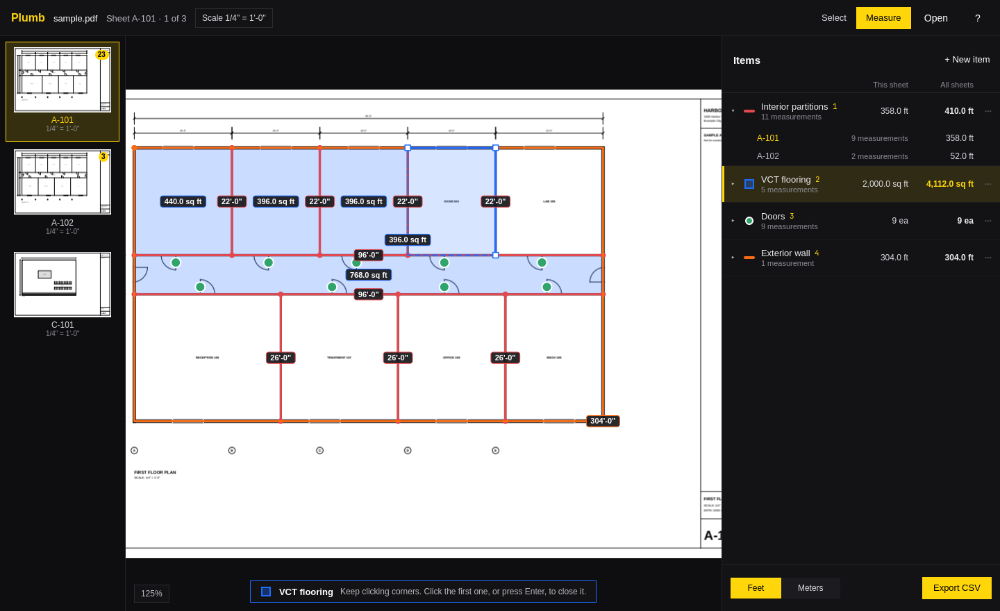

# Plumb

Quantity takeoff on construction drawings, for [Omarchy](https://omarchy.org).
Open a PDF drawing, set its scale, and click on the plan to measure lengths,
areas, and counts. Every measurement belongs to an item, like Drywall or
Concrete slab, and Plumb keeps a running total of each, on the sheet and
across the set, ready to export to CSV.



## What it does

- **Sets the scale per sheet** from the common architectural, engineering,
  and metric scales, or calibrates it from any dimension you know: click both
  ends and type its length (`12'-6"`, `400'`, `3.5`).
- **Measures three ways.** Each item is a length (click along a wall), an area
  (click around a room, then click the first corner again), or a count (click
  each door). Corners snap to other measurements' corners, and Shift keeps
  lines to 45° steps.
- **Groups measurements by item**, each in its own color. Pick an item with
  its number key and start clicking. Move a measurement to another item,
  reshape it by dragging its corners, add a corner by double-clicking an edge,
  or hide an item to see the plan under it.
- **Keeps running totals** for every item on the current sheet and on all
  sheets, with a per-sheet breakdown. A length or area on a sheet with no
  scale is never guessed: it's flagged and left out until the sheet has one.
- **Exports to CSV**, one row per item and sheet and then the item's total,
  in feet or meters. Numbers are plain (`1234.50`) so every spreadsheet reads
  them.
- **Saves as you go**, with undo, in `~/.local/share/plumb/takeoffs/`, keyed
  by the PDF's contents, so the takeoff follows the drawing when it's moved
  or renamed. The PDF itself is never changed.
- Follows the Omarchy theme accent, window rounding, and language live.

## Usage

```sh
plumb open                       # then press O, or drop a PDF on the window
plumb open drawings.pdf
```

### For scripts and coding agents

These need no display, take `--json`, and exit 0 or 1 with errors on stderr.

```sh
plumb sheets drawings.pdf                    # sheets, scales, measurement counts
plumb quantities drawings.pdf --json         # every item's total, sheet by sheet
plumb export drawings.pdf -o quantities.csv  # the CSV the window exports
plumb skill install                          # teach your coding agents to use Plumb
```

## Shortcuts

| Key | Action |
| --- | --- |
| `O` | Open a drawing |
| `S` | Set the sheet's scale |
| `Shift+S` | Calibrate from a known dimension |
| `N` | New item |
| `1` – `9` | Measure that item |
| `M` | Measure the active item |
| `V` | Select, move, and reshape |
| `R` | Edit the active item |
| `H` | Hide or show the active item |
| `Alt+↑` / `Alt+↓` | Move the active item up or down |
| Click | Place a corner, or count one |
| `Space` | Place a corner under the pointer |
| Double-click, `Enter`, right-click | Finish the line or area |
| `Backspace` | Take back the last corner |
| `Shift` | Keep to 45° steps |
| `Alt` | Don't snap to corners |
| `Delete` | Delete the selected measurement |
| Double-click an edge | Add a corner to the selection |
| `Shift`+click a corner | Remove it from the selection |
| `E` | Export quantities to CSV |
| `U` | Switch between feet and meters |
| `L` | Show or hide labels |
| `J` / `Page Down` | Next sheet |
| `K` / `Page Up` | Previous sheet |
| `Home` / `End` | First and last sheet |
| `+` / `-` | Zoom in and out |
| `0` / `F` | Fit the sheet |
| Arrow keys | Pan |
| Wheel | Zoom at the pointer |
| Drag, touchpad scroll | Pan |
| `Ctrl+Z` / `Ctrl+Shift+Z` | Undo and redo |
| `Esc` | Cancel, then back to selecting |
| `?` | Show or hide shortcuts |
| `Q` | Quit |

## Build

Plumb is C++ and Qt Quick, built with qmake. Qt PDF comes from
`qt6-webengine` on Arch.

```sh
bin/build      # builds build/plumb
bin/test       # runs the tests offscreen
bin/install    # builds and installs the package, so Plumb is in the app launcher
```

## License

MIT. The theme and portal file picker code follows
[Omacut](https://github.com/omacom-io/omacut) by David Heinemeier Hansson, also MIT.
The drawing viewer follows Lintel's.
